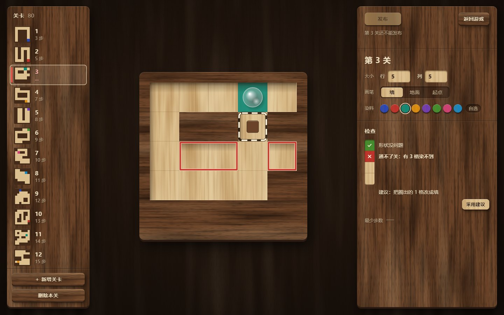

# 染色迷宫

木托盘里一颗蘸了染料的玻璃弹珠：推它一下，它就沿直线一直滚到被墙挡住，滚过的地方被染上颜色。
把迷宫里所有的地面都染上就过关，用的步数越少越好。内置 80 关：前 30 关从 5×5 到 10×10，31–50 关是 15×15 的大图，
51–80 关是更大的长方形（19×15、21×15、23×17），越往后越难，最后一关最少也要 154 步。
关卡也可以在[配置页](#关卡配置)上改、增删、换顺序，点一下发布，所有玩家就玩到新的。

在线试玩：<https://coloring-maze.dengjiabei.cn/>


进度存在浏览器里。画面是 three.js 实时渲染的，木纹、声音都是代码现场生成的，没有图片和音频文件。
唯一的网络请求是启动时向 `/api/levels` 要一次线上发布的关卡表；要不到（没发布过、断网）就用上次留的那份，再没有就用内置的 80 关，照样能玩。

## 怎么玩

| 设备 | 操作 |
| --- | --- |
| 电脑 | 方向键 ↑ ↓ ← → |
| 手机、平板 | 在画面上往想去的方向滑一下（一次滑动走一步） |

- 弹珠每次都滚到头，中途停不下来。朝紧挨着的墙推，弹珠只会磕一下，不算步数。
- 上方是已经走的步数和这一关的**最少步数**（算出来的真正的最小值，不是估计）。
- 通关给星：正好用最少步数 3 星；多走不超过四分之一（至少允许多走 2 步）2 星；其余 1 星。
- 「撤销」退回一步，「重玩」回到这一关的开头。弹珠还在滚的时候可以提前按下一步，最多记两步。
- 打开网站先看到的是**选关树**：一块长木板上刻着一棵树，一关一块圆木片，从树根往上排，上下滚动。
  通过的关写着星级和最好步数，叶子染上了那一关的颜色，可以重玩；外面有一圈亮边的是轮到的那一关；暗的还没轮到，点不动。
  关里的「选关」和通关后的「选关」都回到这棵树上。
- 内置的 80 关无论怎么走都不会走进死局：任何时候剩下的格子都还染得到。（在配置页上自己画的关，这一条只是提醒，不强求。）
- 第一次玩的时候，左下角有一块提示牌讲怎么操作、怎么算过关；通过第 1 关之后它就不再出现。
- 长方形的关卡会看屏幕怎么摆：宽屏上横着放，竖屏的手机上竖着放（同一张图沿对角线翻过来，走法和最少步数都一样）。
  进入一关时定下来，玩到一半把手机转过来也不会变。


## 运行

```bash
npm install
npm run dev      # 开发，http://localhost:5193（配置页在 /config，本地的管理口令是 dev-token）
npm run build    # 类型检查并打包到 dist/
npm test         # 规则、求解器、关卡、接口、存档、界面流程等测试
npm run levels   # 重新生成内置的 80 关（见下）
npm run deploy   # 打包并发布到 Cloudflare（需要先登录 wrangler）
```

`npm run levels` 直接用 Node 运行 TypeScript，需要 Node 22.18 以上。

## 关卡配置

<https://coloring-maze.dengjiabei.cn/config>，只按电脑屏幕做的。进门先输管理口令（只能用英文字母、数字和符号，不能有空格和中文——浏览器不让请求头里带这些）。



- 左边是关卡列表，拖动换顺序，可以新增、删除；中间是格子画布，选了画笔（墙、地面、起点）点一下或按住拖动来画；
  右边改大小（行、列各 5–23，长边最多 23、短边最多 17）、选染料（八种现成的，或者自选颜色）。
- 每改一下都会自动检查：形状（地面连成一片、墙不能只在角上相碰）→ 是不是每一格都滚得到 → 最少几步
  （整数规划，在后台线程里算，大图要几秒到一两分钟，三分钟算不出来就请你把图改简单些）→ 是不是保证不会走进死局。
  通不了关的图发布不了；"不保证不会走进死局"只是提醒（这个判断是保守的：它说没问题就一定没问题，说有风险的不一定真有）。
- 检查不过时会给一条**修改建议**：改尽量少的格子，让这张图既能通关又保证不会走进死局。要改的格子圈在画布上，点「采用建议」一次改好。
  做法是拿"离有保证还差多少"（求解器的 `shortfall`）当尺子：先把只改一格的所有改法试一遍，不行再试两格、三格……最多六格，
  格子多了不再穷举，每一步只留离合格最近的几种接着试（`src/solve/repair.ts`）。图要是离合格太远（比如一大片空地上只有几块墙），
  六格以内改不好，它会如实说没找到。
- 点「发布」：关卡表存进 Cloudflare KV，玩家刷新页面后生效（全球同步最长约一分钟）。只重新算改过图的关。
  服务端只做便宜的核对（格式、尺寸、形状、照着给出的走法确实能通关）；"这是不是最少步数"服务端核不了，信配置页算出来的。
- 长方形的图不用配两套：宽屏上横着摆，竖屏上竖着摆，和内置的关一样。
- 改图没有撤销，全页也只有"有没发布的修改时离开"这一处确认：删掉一关、把图改小都是一下就没了。还没发布的话，刷新页面可以回到线上那一份。
- 刚发布完的一两分钟里，Cloudflare 那边有可能还在回上一版。这期间在同一个浏览器里刷新配置页，显示的是你刚发布的那一份
  （它记在浏览器里，两分钟内以它为准）；换一台电脑打开的话，等一分钟再看。

**存档跟着关卡走**：每一关有一个固定的编号（内置的是 `b01`–`b80`），成绩按编号记，改图、换顺序都不会张冠李戴。
一关的图被改过之后，原来的最好步数和星星清掉（重玩才有），但仍然算通过，后面的关不会突然锁上。
哪些关能玩只有一条规则：这一关通过了，或者排在它前一位的那一关通过了；排第一的总能玩——所以中间插进新关不会把老玩家卡回去。

**后端**只有一个很小的 Worker（`worker/`）：读关卡表（GET `/api/levels`）谁都可以；验口令（POST）和发布（PUT）要在请求头里带管理口令。
口令是 Worker 的密钥 `LEVEL_ADMIN_TOKEN`，没配的话拒绝一切写入。每次发布前，旧的那份另存在 KV 的 `levels:prev` 这个键里，
发错了可以用 wrangler 手动恢复。

第一次部署前要做两件事（之后只用 `npm run deploy`）：

```bash
npx wrangler kv namespace create coloring-maze-levels   # 把得到的 id 填进 wrangler.jsonc 的 kv_namespaces
npx wrangler secret put LEVEL_ADMIN_TOKEN               # 自己敲管理口令，它不进代码仓库
```

本地开发不需要 wrangler：开发服务器和预览服务器里带着同一个接口（`tools/dev-api.ts`），
拿 `node_modules/.cache/coloring-maze/dev-kv.json` 这个文件当 KV，口令固定是 `dev-token`。

## 内置的 80 关是怎么来的

关卡不是手画的，是生成器造出一大批候选、逐个算出最少步数、再按难度曲线挑出来的（`tools/build-levels.ts`）。

- **三种造法**（`tools/gen.ts`）：「开凿」——让小球在一整块木头里一步步滚，滚到哪凿到哪，出来的是走廊和小房间；
  「摆木块」——在空地上随机摆几块木块，可以摆成中心对称，出来的是开阔的样子，10×10 以内的难关大多是这种；
  「修补」——15×15 以上的图太大，随机摆的木块几乎不可能正好通得了关（两千张里一两张），所以摆完接着一格一格地改：
  每改一格都看这张图离"保证不会困死"是近了还是远了，没变远就留下，改到合格为止。长方形的大图全是这样造的。
- **求解器**（`src/game/solver.ts`）对每个候选回答三个问题：能不能通关、最少几步、会不会走进死局。
  小球只会停在少数几个格子上，而且很多格子总是被"顺带"染上，所以只需要记住"停在哪 + 若干个关键格染了没有"。
  10×10 以内的图关键格只有十几二十个，从开局一层层全搜就行。15×15 的图有一百来个，全搜搜不完，
  改用 A* 搜索：把关键格十六个一组，每组事先算好一张表——"只管这一组，从这里最少还要几步"；各组里最大的那个数
  就是整关"至少还要几步"，搜索时先走"已走步数 + 至少还要几步"最小的局面。
- **更大的图换一种算法**（`src/solve/tour.ts`，配置页算最少步数用的也是它）。比 15×15 再大的开阔图，上面的搜索几百万个局面也搜不完。换个角度看：
  小球的走法是"停靠点"之间的一条路，每一步染一些格子，要的是把每个关键格都至少染到一次的最短的路——
  这可以写成一道整数规划（每一步走几次是未知数；除了头尾，每个停靠点进几次就出几次；每个关键格至少被染到一次；
  走过的步要连成一片），交给开源的求解库 HiGHS 去解，23×17 的图几秒到几十秒就能解出来，而且是带证明的最优。
  两种算法走的是完全不同的路，在几百张两边都算得动的图上（包括 31–50 关）答案逐一对过（`tests/mip.test.ts`）。
- **难度曲线**：尺寸不减、最少步数不减（3 步 → 154 步）；同时估计"不做规划、走一步看一步"会比最少步数多走几步，
  越往后挑这个差距越大的，也就是越需要事先想好路线。31–39 关是凿出来的大迷宫（36–49 步），40–50 关是开阔的图
  （54–75 步），51–60 关 19×15（78–96 步），61–70 关 21×15（99–121 步），71–80 关 23×17（125–154 步）。
- 候选存在 `node_modules/.cache/coloring-maze/`，种子固定，重跑得到同样的 80 关。15×15 和长方形的候选算起来慢，
  会分给十几个线程一起算（14 核的电脑上 15×15 要 8 分钟左右、4 GB 内存，三种长方形各要 13 到 30 分钟）。
  生成的结果是 `src/game/levels.ts`。测试会把每一关重新算一遍，确认能通关、不会困死、标的最少步数是对的
  （前 50 关用求解器；后 30 关用整数规划确认"再少一步就走不通"，分在 `tests/levels-51.test.ts` 等几个文件里同时跑），
  还会确认前 50 关一格没变——玩家存着的成绩是按它们记的。

顺带一提：做这个游戏时参考的那段视频里的关卡其实通不了关（有 5 格从起点怎么滚都到不了），它也被收进了求解器的测试里。

## 画面是怎么做的

- **托盘**（`src/view/tray.ts`）：照着激光切割的木头玩具来做——下面一层浅色桦木夹板，上面一层挖出迷宫的胡桃木面板，
  断面是烧焦的深色，托盘外侧能看到夹板的分层。面板的轮廓由关卡的格子描出来（`outline.ts`）再挤出成形。
  边框上的「染色迷宫」和「第 N 关」是刻进木纹贴图里的。迷宫是长方形时托盘也是长方形，长的那一边总是一样长。
- **木纹**（`wood.ts`）：照着真木头的构造画。树干是一圈套一圈的年轮，木板是顺着树干锯下来的一片，板面和年轮斜着相交，
  所以看到的是一个套一个的拱形"山纹"，越靠板边越密越直；一圈年轮里颜色由浅渐深、到头突然变回浅色；
  顺纹是一两个像素宽的木纤维；胡桃木上还有被锯开的导管留下的一道道小黑槽。这些细节要画到像素那么细才像真的，
  逐点用 JavaScript 算太慢，所以交给显卡画（一个片元着色器，启动时画三张：桦木、胡桃木、桌面），画完读回画布。
  同时画出一张起伏图，导管在上面是凹下去的小槽，光照过来木头表面有细微的凹凸。
- **染色**（`stain.ts`）：每个格子在一张小数据图里记四个时刻（什么时候染上、染料从哪渗开、最后一次被滚过、什么时候开始褪色），
  着色器拿"现在几点"去比，自己算出染料渗到哪了、边缘有多毛、还有多湿——刚滚过的地方更暗、会反光，一两秒后才干。
  格线是底板上刻出来的细线，染料会积在线里。
- **弹珠**（`marble.ts`）：真正透光、折射的玻璃球，里面是拧成麻花的四片色芯，球滚的时候色芯跟着转。
  玻璃球的影子不是普通的黑影：外圈暗、中间有一块被球聚出来的亮斑，这是底板的着色器按球的位置和光的方向算出来的。
- **动效**（`view.ts`、`motion.ts`）：弹珠匀加速滚出去、撞墙时回弹一小下再停稳；托盘朝滚动的方向极轻微地一倾
  （半度多一点，刚好能察觉），撞墙时放平并被带得一晃；撞墙溅起几滴染料；换关时旧托盘滑走、新托盘滑进来，
  弹珠从上方落下、弹两下。
- **取景**（`framing.ts`）：相机固定俯视，只算"离多远、画面平移多少"才能把托盘尽量大地放进界面留出的那一块。
  换到大小不一样的托盘时，镜头趁着托盘滑进来的工夫平滑地移过去。
- 画面静止六秒后停止渲染（不费电）。画多细按屏幕大小和显卡的档次来定，带不动就画粗一档；
  画粗了也没变快（比如手机开着省电模式、被限在每秒 30 帧）就改回去，不白白变糊（`sharpness.ts`）。
- **声音**（`src/audio/sound.ts`）：撞墙、落地、滚动、托盘滑动、通关的铃音，全部用 Web Audio 合成。

## 目录

```
src/
  game/            规则与数据（纯 TypeScript，有测试）
    level.ts         关卡的字符画 → 迷宫；把一关沿对角线翻过来
    rules.ts         滚动、染色、撤销、通关判定
    solver.ts        求解器：最少步数、会不会困死
    shape.ts         迷宫形状上的两条要求（地面连成一片、墙不能只在角上相碰）
    levels.ts        内置的 80 关（生成的，不要手改）
    levelset.ts      关卡表的格式和校验（游戏、配置页、服务端共用）
    remote.ts        启动时拿线上的关卡表，拿不到就一步步退回内置的
    stars.ts         给几颗星
    progress.ts      存档：按关卡编号记成绩，哪些关能玩
  solve/           配置页和关卡生成共用的两样：最少步数（tour.ts，整数规划）、修改建议（repair.ts）
  view/            three.js 画面
  ui/              选关树、步数、按钮、新手提示牌、通关面板，键盘与滑动
  config/          配置页（第二个页面 config.html）：编辑模型、检查、后台线程、界面
  audio/           声音
  app.ts           把游戏这一页串起来
worker/            Cloudflare Worker：关卡接口 /api/levels
tools/             关卡生成（gen.ts 造图、mip.ts 在 Node 里加载求解库、build-levels.ts 挑选）、
                   开发服务器里的假接口（dev-api.ts）、字体子集
tests/             测试
  helpers/brute.ts          用来核对求解器的穷举法
  helpers/fake-browser.ts   假浏览器：手动拨的钟、手动出的帧、够用的一点点 DOM
  helpers/prove.ts          51 关以后每一关"再少一步就走不通"的检查
  app.test.ts               把整个游戏放进假浏览器里一帧帧地跑（只有碰 WebGL 的舞台是替身），
                            包括"乱按一气"之后规则、画面、界面、存档是否还对得上
```

## 字体

界面和托盘上的字是思源宋体（Noto Serif SC）粗体的一个子集，只含用到的不到一百个字（29 KB）。
字体按 SIL OFL 1.1 授权，全文在 `public/fonts/OFL.txt`。界面文字有增减后重新生成：

```bash
node tools/subset-font.mjs <NotoSerifSC-Bold.otf 的路径>
```

## 依赖

游戏那一页只依赖 three.js。[HiGHS](https://highs.dev/)（npm 包 `highs`，编译成 WebAssembly 的求解库，MIT 授权）用来算最少步数：
配置页的后台线程里用，生成和检查内置关卡时也用；它不会打进游戏那一页，玩家不用下载。配置页不加载 three.js。

开发时 npm 官方源连不上，依赖是从 `registry.npmmirror.com` 装的，`package-lock.json` 里记录的也是这个地址。
需要换回官方源时，删掉 `package-lock.json` 重新 `npm install` 即可。
